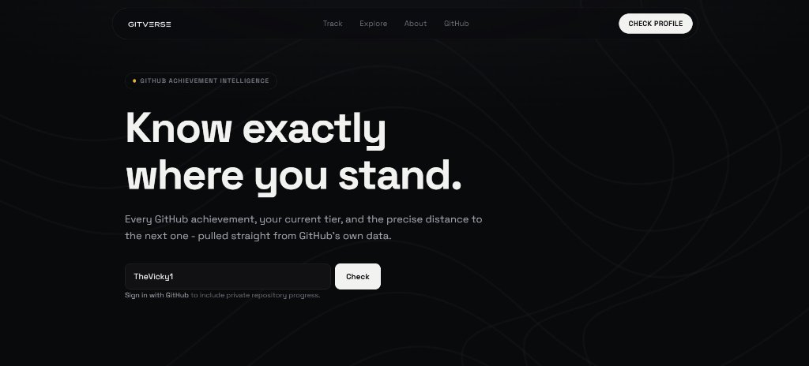

<div id="top"></div>

<div align="center">


# GitVerse - GitHub Achievement Intelligence Platform

**Deterministic Milestone Visibility & Real-Time Achievement Verification.**  
*Know exactly where you stand. Turn opaque badges into actionable developer milestones.*

<br />

[](https://gitverse.vercel.app)
[](https://github.com/TheVicky1/GitVerse/actions/workflows/test.yml)
[](LICENSE)
[](https://github.com/TheVicky1/GitVerse/releases)
[](https://hacktoberfest.com/)
[](https://github.com/TheVicky1/GitVerse/issues?q=is%3Aissue+is%3Aopen+label%3A%22good+first+issue%22)
[](https://www.firsttimersonly.com/)
[](CONTRIBUTING.md)
[](https://go.dev/)
[](docs/SECURITY.md)

<br />

> 🌐 **Live Web Intelligence Platform**: Access GitVerse in your browser at **[https://gitverse.vercel.app](https://gitverse.vercel.app)**  
> ⚡ **Compiled Terminal CLI**: Install globally via `go install github.com/TheVicky1/GitVerse/cmd/gitverse@latest`

<br />

[Live Demo](https://gitverse.vercel.app) · [Track Profile](https://gitverse.vercel.app/check/) · [Explore Badges](https://gitverse.vercel.app/achievements/) · [About](#about) · [Quick Start](#quick-start) · [Dual-Engine](#dual-engine-architecture) · [Features](#core-features) · [Documentation](#documentation) · [Contributing](#contributing)

<br />

<a href="https://gitverse.vercel.app">
  
</a>

</div>

---

<div align="center">
  <h2>About GitVerse</h2>
</div>

While GitHub proudly showcases unlocked achievements on user profiles, it deliberately obscures what lies ahead. Upcoming tier thresholds are unexposed, progress counters are omitted from the native UI, and GitHub's official public API contains zero achievement endpoints. Developers are left to guess how close they are to reaching their next tier.

**GitVerse eliminates this asymmetry.**

Through deterministic reverse-calibration, GitVerse reads public badge histories, milestone unlock records, and activity telemetry to construct an exact, real-time map of your progress. Every number in the generated report is rigorously classified by provenance:

* **Official:** Extracted directly from GitHub's native profile schemas.
* **Calibrated:** Correlated with verified milestone thresholds across actual repositories.
* **Counted:** Computed in real-time from active repository contribution events.

### Foundational Principles

1. **Deterministic Accuracy**: Never display speculative numbers. If a metric cannot be calibrated against verified milestones, GitVerse displays the verified official tier floor.
2. **Zero-Retention Privacy**: No database, no tracking cookies, no credentials stored. OAuth access tokens used for private repository calculation are held in memory for a single execution pass and revoked immediately.
3. **Dual-Engine Architecture**: The exact same battle-tested analytical engine powers both a compiled command-line binary for terminal power-users and a blazing-fast responsive web application on Vercel.
4. **Community-Driven Open Source**: 100% open-source under the permissive MIT License, welcoming developers of all experience levels with structured micro-issues and fast-track PR reviews.

---

<div align="center">
  <h2>Quick Start</h2>
</div>

### 1. Web Intelligence Platform (Zero Install)

The fastest way to inspect any profile is directly in the browser:

1. Visit **[gitverse.vercel.app/check/](https://gitverse.vercel.app/check/)**.
2. Enter any public GitHub username, including your own.
3. Or click **Sign in with GitHub** to securely analyze private repository milestones with instantaneous token revocation.

### 2. High-Performance Terminal CLI

Engineers who live in the terminal can install and run GitVerse natively:

#### Prerequisites
- [Go 1.25+](https://go.dev/dl/) installed on your system.
- Optional: [GitHub CLI (`gh`)](https://cli.github.com/) for automatic private repository authentication.

```bash
# 1. Install the GitVerse CLI binary globally
go install github.com/TheVicky1/GitVerse/cmd/gitverse@latest

# 2. Check your own profile (automatically reuses your existing gh auth)
gitverse

# 3. Check any public GitHub profile
gitverse <username>

# 4. Include the complete catalog archive, staff badges, and notes
gitverse --all

# 5. Output structured JSON for automation or shell scripts
gitverse --json <username>
```

---

<div align="center">
  <h2>Dual-Engine Architecture</h2>
</div>

GitVerse is engineered from the ground up as a synchronized dual-engine system:

```text
                     +---------------------------------------+
                     |         Developer Entrypoints         |
                     +---------------------------------------+
                            /                         \
            [ Web Intelligence (Vercel) ]      [ Terminal CLI (Go) ]
            - Serverless Edge Handlers          - Standalone Compiled Binary
            - OLED Aurora Responsive UI         - Terminal ANSI Color Shelves
            - Interactive Category Drawers      - Machine-Readable JSON Mode
                            \                         /
                             +-----------------------+
                             |  GitVerse Core Engine |
                             +-----------------------+
                                         |
               +-------------------------+-------------------------+
               |                         |                         |
      [ Catalog Engine ]        [ Calibration Unit ]      [ Provenance Classifier ]
      - 15 Badges               - Pull Shark (Merged PRs)  - Official Verified
      - 4 Tier Thresholds       - Starstruck (Stargazers) - Calibrated Milestone
      - 6 Profile Highlights    - Galaxy Brain (Answers)   - Counted Telemetry
               |                         |                         |
               +-------------------------+-------------------------+
                                         |
                         +-------------------------------+
                         |   GitHub Telemetry Pipeline   |
                         +-------------------------------+
                                 /               \
                 [ Public Profile Scraper ]   [ Live GraphQL & REST API ]
                 - Profile History & Tiers    - Authenticated PR & Star Counts
                 - In-Memory Parallel Fetch   - Zero Stored Tokens (Revoked)
```

> For deep architectural details, see the [Architecture Guide](docs/ARCHITECTURE.md) and [Data Model Specification](docs/DATA_MODEL.md).

---

<div align="center">
  <h2>Core Features</h2>
</div>

| Achievement | How It Is Earned | Tiers & Milestone Thresholds | Provenance |
| :--- | :--- | :---: | :---: |
| **Pull Shark** | Open pull requests that get merged | **x1:** 2 &nbsp;·&nbsp; **x2:** 16 &nbsp;·&nbsp; **x3:** 128 &nbsp;·&nbsp; **x4:** 1,024 | `calibrated` |
| **Starstruck** | Create a repository that earns stars | **x1:** 16 &nbsp;·&nbsp; **x2:** 128 &nbsp;·&nbsp; **x3:** 512 &nbsp;·&nbsp; **x4:** 4,096 | `calibrated` |
| **Pair Extraordinaire** | Coauthor commits on merged pull requests | **x1:** 1 &nbsp;·&nbsp; **x2:** 10 &nbsp;·&nbsp; **x3:** 24 &nbsp;·&nbsp; **x4:** 48 | `official` |
| **Galaxy Brain** | Have discussion answers accepted | **x1:** 2 &nbsp;·&nbsp; **x2:** 8 &nbsp;·&nbsp; **x3:** 16 &nbsp;·&nbsp; **x4:** 32 | `counted` |
| **Quickdraw** | Close an issue or PR within 5 minutes of opening | **Single Tier** (Achievement Unlocked) | `official` |
| **YOLO** | Merge a pull request without an approving review | **Single Tier** (Achievement Unlocked) | `official` |
| **Public Sponsor** | Sponsor an open-source contributor via GitHub Sponsors | **Single Tier** (Achievement Unlocked) | `official` |
| **Finishing Touch** | Get pull requests improving GitHub's UI quality merged | **x1:** 1 &nbsp;·&nbsp; **x2:** 4 &nbsp;·&nbsp; **x3:** 16 &nbsp;·&nbsp; **x4:** 32 | `official` |
| **Arctic Code Vault** | Contributed code to 2020 GitHub Archive Program | *Retired Historical Badge* | `official` |
| **Mars 2020 Contributor** | Contributed to repositories used in Mars 2020 mission | *Retired Historical Badge* | `official` |

---

<div align="center">
  <h2>Visual Identity & Design Philosophy</h2>
</div>

GitVerse is crafted with a signature **Space Aurora** minimalist luxury dark mode aesthetic:

* **OLED Obsidian Canvas**: Deep `#0a0a0b` canvas foundation eliminating interface fatigue.
* **Aurora Topographic Contours**: Subtle, glowing vector contour lines (`rgba(255, 255, 255, 0.035)`) evoking orbital navigation.
* **Precious Metal Medal Shelves**: Tier indicators styled with authentic metallic finishes:
  * 🥇 **Gold (x4)**: `#c9971f`
  * 🥈 **Silver (x3)**: `#e2e8f0`
  * 🥉 **Bronze (x2)**: `#d97706`
  * 🔘 **Base (x1)**: `#71717a`
* **Zero Layout Jitter**: Interactive loading spinners and predictive prefetch caching ensure smooth transitions under 20ms.

> For complete guidelines, typography scales, and token values, see the [Design System Specification](docs/DESIGN_SYSTEM.md).

---

<div align="center">
  <h2>Project Structure</h2>
</div>

```text
GitVerse/
├── .github/                   # Workflows (CI, release, canary), issue & PR templates
│   ├── ISSUE_TEMPLATE/        # Structured YAML issue templates
│   └── workflows/             # Automated test, canary, and release automation
├── api/                       # Vercel Serverless Function entrypoints
│   ├── markdown/              # Content-negotiated Markdown representations
│   ├── private/               # Ephemeral private calculation & token revocation
│   └── result/                # Public report serverless handler
├── cmd/
│   ├── gendocs/               # SSG & documentation generation engine
│   └── gitverse/              # Main compiled CLI application entrypoint
├── docs/                      # Comprehensive technical & contributor documentation
│   ├── assets/                # Logos, screenshots, and visual assets
│   ├── ARCHITECTURE.md        # Dual-engine system architecture
│   ├── CONTRIBUTING-BEGINNERS.md # Step-by-step first PR guide
│   ├── DATA_MODEL.md          # Schema specifications & provenance rules
│   ├── DESIGN_SYSTEM.md       # Color tokens, typography, and styling
│   ├── FEATURES.md            # Complete catalog breakdown and unlock rules
│   └── SECURITY.md            # Zero-retention security guarantees
├── internal/
│   ├── catalog/               # Single source of truth for all 15 achievements
│   ├── counters/              # Live API telemetry collectors (PRs, stars, discussions)
│   ├── official/              # GitHub HTML profile parsers & detail extraction
│   ├── progress/              # Tier milestone calculations and calibration floor
│   ├── render/                # Terminal ANSI color & shelf formatting
│   ├── report/                # Aggregator binding profile data & live counters
│   └── webui/                 # Web templates, static assets, and scripts
├── site/                      # Static production site assets and documentation
├── scripts/                   # Local preview server, asset generators, benchmarks
├── CHANGELOG.md               # Semantic Versioning release history
├── CONTRIBUTING.md            # Comprehensive contributor guidelines
├── CONTRIBUTORS.md            # Community recognition hall of fame
├── LICENSE                    # Permissive MIT License
└── SECURITY.md                # Responsible vulnerability disclosure policy
```

---

<div align="center">
  <h2>Documentation</h2>
</div>

Comprehensive technical specifications, operational runbooks, and contributor guides are maintained in [`docs/`](docs/README.md):

| Document | Purpose |
| :--- | :--- |
| 🌱 [**Beginner Contributing**](docs/CONTRIBUTING-BEGINNERS.md) | Step-by-step zero-to-PR walkthrough for first-time open-source contributors |
| 💻 [**Windows Setup Guide**](docs/CONTRIBUTING-WINDOWS.md) | Environment configuration and PowerShell instructions for Windows developers |
| 🏗️ [**Architecture**](docs/ARCHITECTURE.md) | Dual-engine system architecture, in-memory execution, and data flow |
| 📋 [**Feature Inventory**](docs/FEATURES.md) | Full breakdown of all 15 achievements, tiers, and profile highlights |
| 🗄️ [**Data Model**](docs/DATA_MODEL.md) | Provenance levels (`official`, `calibrated`, `counted`) and badge schemas |
| 🎨 [**Design System**](docs/DESIGN_SYSTEM.md) | Space Aurora aesthetic, OLED obsidian canvas, and medal shelf tokens |
| 💻 [**Development Guide**](docs/DEVELOPMENT.md) | Local environment setup, preview server, and build commands |
| 🧪 [**Testing Strategy**](docs/TESTING.md) | Weekly canary test suites, unit testing, and mock verification |
| 🔒 [**Security Architecture**](docs/SECURITY.md) | Zero-retention model, in-memory execution, and token revocation |
| 🌿 [**Git Workflow**](docs/GIT_WORKFLOW.md) | Conventional Commits, branch hygiene, and PR standards |
| 📦 [**Release Management**](docs/RELEASE_MANAGEMENT.md) | Semantic Versioning policy and release milestone checklists (v1.0–v1.3) |
| 🗺️ [**Product Roadmap**](docs/ROADMAP.md) | Implementation milestones and planned platform features |
| 🔧 [**Troubleshooting**](docs/TROUBLESHOOTING.md) | Practical fixes for rate limits, token scopes, and local preview issues |
| 🌐 [**GitHub Metadata**](docs/GITHUB_METADATA.md) | Repository tags, descriptions, and open-source directory metadata |

---

<div align="center">
  <h2>Contributing</h2>
</div>

Contributions are warmly welcomed! GitVerse is designed to be one of the most welcoming and well-structured open-source developer tools on GitHub.

> 🚀 **New to Open Source? Start with a Micro-Contribution!**  
> We deliberately scope our beginner tasks into **single-file micro-issues** (15–30 minutes) with exact file pointers, clear acceptance criteria, and step-by-step guidance.  
> 👉 [**Browse Good First Issues**](https://github.com/TheVicky1/GitVerse/issues?q=is%3Aissue+is%3Aopen+label%3A%22good+first+issue%22) &nbsp;|&nbsp; 📖 [**Read the Beginner's Guide**](docs/CONTRIBUTING-BEGINNERS.md)

### 🌟 Why Contribute to GitVerse?

* **⚡ Instant Local Setup**: Run the local preview server in seconds with zero complex database setup.
* **🎯 Highly Scoped Micro-Issues**: Tasks touch isolated components, parser fixtures, or documentation files with unambiguous verification steps.
* **🚀 Fast Maintainer Feedback**: Pull requests receive prompt, constructive reviews from the core maintainer team.
* **🏛️ Permanent Recognition**: Every contributor is permanently acknowledged in [**CONTRIBUTORS.md**](CONTRIBUTORS.md) and on the [**GitHub Contributors Graph**](https://github.com/TheVicky1/GitVerse/graphs/contributors).

### ⚡ 6-Step Contributor Workflow

1. **Pick an Issue**: Browse [**Good First Issues**](https://github.com/TheVicky1/GitVerse/issues?q=is%3Aissue+is%3Aopen+label%3A%22good+first+issue%22).
2. **Fork & Clone**: Fork GitVerse and clone it locally:
   ```bash
   git clone https://github.com/<your-username>/GitVerse.git
   cd GitVerse
   ```
3. **Create a Feature Branch**:
   ```bash
   git checkout -b feat/achievement-milestone-enhancement
   ```
4. **Make Your Change**: Edit the designated files following project guidelines.
5. **Verify Locally**:
   ```bash
   node scripts/serve-preview.cjs
   node --test internal/webui/jstest/*.test.mjs
   ```
6. **Submit a Pull Request**: Push your branch and open a PR with a description of your work.

---

<div align="center">
  <h2>Contributors & Community</h2>
</div>

GitVerse is crafted and maintained with care by **[Vicky Patel](https://github.com/TheVicky1)** alongside an exceptional community of open-source developers.

<div align="center">

[](https://github.com/TheVicky1/GitVerse/graphs/contributors)

[](https://github.com/TheVicky1/GitVerse/graphs/contributors)

*A huge thank you to everyone who has contributed to making GitHub achievements transparent and deterministic!*

👉 [**View all contributors on GitHub**](https://github.com/TheVicky1/GitVerse/graphs/contributors) • [**Contributors Hall of Fame**](CONTRIBUTORS.md)

</div>

---

<div align="center">
  <h2>License</h2>
</div>

GitVerse is open-source software distributed under the permissive [MIT License](LICENSE).

---

<div align="center">

**Deterministic. Transparent. Engineered for Clarity.**

[⬆ Back to top](#top)

</div>
